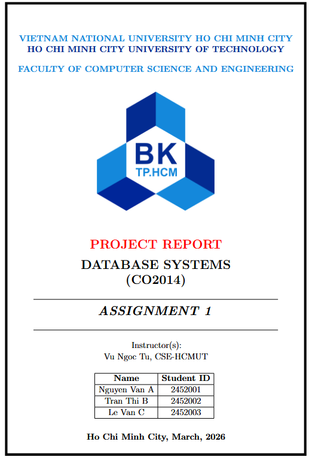

# LaTeX Report Template — HCMUT

A reusable LaTeX report template: parameterised cover, one member list that
fills both member tables, optional front/back matter, theorem boxes, code
listings and a biblatex bibliography.



## Features

- **Cover built from fields** — organisation, course, code, title, instructor
  and date are macros in one file; nothing is typed twice.
- **One member list** — a single `\memberrow{name}{id}{role}{percent}` per person
  produces the cover table *and* the roles/completion page, numbered
  automatically. No `\multirow` bookkeeping.
- **Rebrand with two edits** — swap `images/logo.png`, change three lines.
- **Optional pages** — abstract, list of figures, list of tables, appendix,
  member pages: one `true`/`false` each.
- **Fonts of writing** — `theorem`, `definition`, `problem`, `example`,
  `corollary`, `solution`, `Proof`, syntax-highlighted `lstlisting`,
  `\codeinline{}`, booktabs tables, `tabularx`, landscape pages.
- **biblatex + biber** (IEEE by default, one line to switch to APA).
- **Page X** footer, logo + running title header, roman front matter then
  arabic body.

## Structure

Git history and the LaTeX sources are kept apart: `.git` stays on your machine,
`report/` is what Overleaf gets.

```
report-template/
├── .git/                 history only — never uploaded
├── report.zip            generated, ready to upload (not tracked)
├── assets/cover.png      preview image
├── README.md
└── report/               ← THE LATEX PROJECT
    ├── main.tex          document order + on/off switches
    ├── metadata.tex      cover text and running header
    ├── members.tex       one list, fills both member tables
    ├── refs.bib          bibliography
    ├── sections/
    │   ├── 00-abstract.tex
    │   ├── 01-introduction.tex   demo, replace it
    │   ├── 99-conclusion.tex
    │   └── A-appendix.tex
    ├── images/logo.png
    └── format/
        ├── preamble.sty  packages, palette, header/footer, boxes
        └── cover.tex     cover page + member roles page
```

## Quick start

1. Copy `report/` and rename it after the project.
2. Fill in `metadata.tex` and `members.tex`.
3. Write `sections/`, adding one `\input{sections/...}` line in `main.tex` per
   file.

```latex
% metadata.tex
\newcommand{\orglineA}{VIETNAM NATIONAL UNIVERSITY HO CHI MINH CITY}
\newcommand{\orglineB}{HO CHI MINH CITY UNIVERSITY OF TECHNOLOGY}
\newcommand{\orglineC}{FACULTY OF COMPUTER SCIENCE AND ENGINEERING}

\newcommand{\doctype}{PROJECT REPORT}      % the red line on the cover
\newcommand{\coursename}{DATABASE SYSTEMS}
\newcommand{\coursecode}{CO2014}
\newcommand{\reporttitle}{ASSIGNMENT 1}
\newcommand{\instructor}{Vu Ngoc Tu, CSE-HCMUT}
\newcommand{\locationdate}{Ho Chi Minh City, March, 2026}
\newcommand{\reporthead}{Database Systems Assignment}
```

```latex
% members.tex — name, student ID, role, completion %
\newcommand{\members}{%
    \memberrow{Nguyen Van A}{2452001}{Analysed requirements, wrote section 1}{100}%
    \memberrow{Tran Thi B}{2452002}{Designed the EERD and schema}{100}%
}
```

## Optional pages

```latex
\newif\ifshowmembers  \showmemberstrue    % cover member table + roles page
\newif\ifshowabstract \showabstracttrue   % abstract
\newif\ifshowlof      \showloftrue        % list of figures
\newif\ifshowlot      \showlottrue        % list of tables
\newif\ifshowappendix \showappendixtrue   % appendix
```

## Rebranding

1. Replace `images/logo.png` with your logo (keep the filename).
2. Change the three `\orgline` entries in `metadata.tex`.

Optional: the palette is at the top of `format/preamble.sty` (`lblue`, `dblue`,
`blued`, `blu`, `gray1`, `jspink`, `gree`, ...). Leave an `\orgline` empty to
hide it; `\reportlogofalse` removes the logo from cover and header.

## Writing

| Need | How |
|---|---|
| Image | `\includegraphics[width=0.8\linewidth]{diagram.png}` — files in `images/` are found automatically, names are case-sensitive |
| Full-width table | `tabularx` + `booktabs`, see `sections/A-appendix.tex` |
| Box | `\begin{definition}[Title] ... \end{definition}`, likewise `theorem`, `problem`, `example`, `corollary`, `solution` |
| Code | `\begin{lstlisting}[language=SQL] ... \end{lstlisting}` or `\codeinline{SELECT * FROM t;}` |
| Citation | add to `refs.bib`, then `\textcite{key}` / `\parencite{key}` |
| Cross-reference | `\ref{fig:x}`, `\autoref{tab:y}`, `\eqref{eq:z}` |

References print at the end via `\printbibliography` and appear in the table of
contents. Change `style=ieee` in `format/preamble.sty` for `apa` or `numeric`.

## Build on Overleaf

1. Upload `report.zip` — **New Project → Upload Project**.
2. Compiler **pdfLaTeX**; `main.tex` is at the project root, so it is the main
   document automatically.
3. Biber runs automatically. If citations show `[?]`, recompile once more.

Regenerate the zip after committing changes:

```bash
git archive --format=zip -o report.zip HEAD:report
```

Prefer that over Windows' `Compress-Archive`: it writes backslash separators
that Overleaf's unzip treats as literal filenames.

Vietnamese text needs **XeLaTeX** and `fontspec` instead of `inputenc`/`fontenc`
— see the comment in `format/preamble.sty`.

## The original report

This template was cleaned from a database-systems assignment (YouMed EERD). The
untouched original is preserved in git:

```bash
git log --oneline
git archive 4dec451 -o original-report.zip
```

## Requirements

TeX Live 2022 or newer (Overleaf is fine). Packages used are all in a standard
full install: `geometry`, `fancyhdr`, `graphicx`, `tikz`, `tcolorbox`,
`thmtools`, `mdframed`, `listings`, `tabularx`, `booktabs`, `biblatex`,
`hyperref`.
